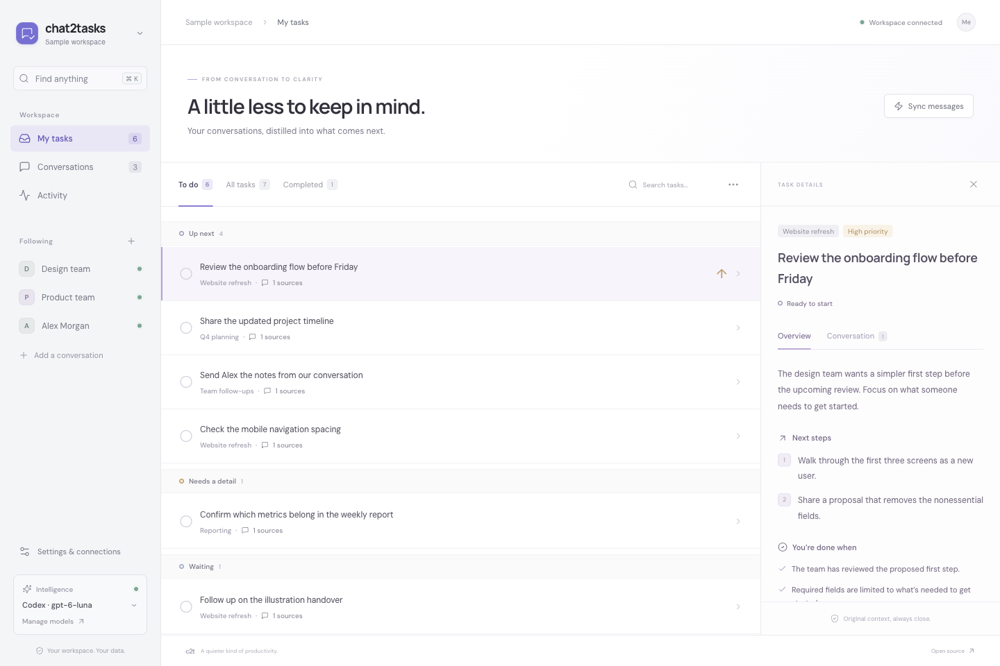

# Chat2Tasks

A little less to keep in mind. Turn selected WhatsApp conversations into clear, traceable tasks, with your choice of AI model.

Self-hosted, Docker based, and written in TypeScript: React + Vite, Fastify, and SQLite. The interface takes cues from [Linear](https://linear.app) and [Apple’s Human Interface Guidelines](https://developer.apple.com/design/human-interface-guidelines): a quiet sidebar, focused task lists, and details revealed when you need them.



## Start with Docker

```sh
git clone https://github.com/liongkj/chat2tasks.git
cd chat2tasks
cp .env.example .env
docker compose up -d --build
```

Open **http://127.0.0.1:2786**. In **Conversations**, enter your OpenWA server URL and API key. Find a session and its chats, or add a chat by ID. New chats start paused; activate only the conversations you want to process.

OpenWA is a separate prerequisite. Point Chat2Tasks at an existing compatible OpenWA installation. If it is another Compose stack, attach Chat2Tasks to that stack’s network with a Compose override. `localhost` inside the container refers to Chat2Tasks, not your host; on Docker Desktop use `host.docker.internal` for a host service. On Linux configure `host-gateway` or a shared Docker network.

The default port is 2786. If you change `PORT` in `.env`, also set `PUBLIC_ORIGIN=http://127.0.0.1:YOUR_PORT`.

## Model connections

Use **Settings & connections** to add, name, test, and select connections. The sidebar selector switches the active connection for subsequent AI calls. In-flight requests finish on the connection they started with. Model IDs are editable; there is no fixed provider catalog.

* **Codex subscription.** Sign in once inside the running container:

  ```sh
  docker compose exec chat2tasks codex login --device-auth
  ```

  Choose a model supported by your account. Codex sessions persist in the `codex-home` volume. Calls run without shell, app, plugin, or skill tools. The default model carries forward the original app’s configuration; change it if your account exposes different IDs.
* **OpenAI-compatible API.** Supply a base URL ending at the API version (for example `https://api.openai.com/v1`), an API key, and a model ID. OpenAI, OpenRouter and compatible local servers can use this adapter. **Load models** queries `/models` if the endpoint supports it; manual IDs always work. Providers must support non-streaming Chat Completions with JSON text responses. Screenshot analysis also requires image input support.
* **Cloudflare AI Gateway proxy.** Supply your account ID, gateway ID, OpenAI provider key, and an optional authenticated-gateway token. Requests use the OpenAI provider-native proxy with the provider key in `Authorization` and the gateway token in `cf-aig-authorization`. Other compatible gateway paths can be configured using a compatible API connection.
* **Cloudflare REST API with unified billing.** Select unified billing and use a Cloudflare token with **Account → Workers AI → Read** permission. Model IDs use `author/model`, or `@cf/author/model` for Workers AI. Calls use `/accounts/{account}/ai/v1/chat/completions` and `cf-aig-gateway-id`, following [Cloudflare’s current REST API](https://developers.cloudflare.com/ai-gateway/usage/rest-api/). Model access, credits and billing remain with your provider.

**Test connection** makes one small, billable model request. Saving a connection does not run a test; normal active-chat processing continues in the background. Selected models must return valid schema JSON. Invalid task output is rejected without marking its source messages processed.

## How it works

1. Only activated conversations are fetched and processed. Pausing retains existing tasks and cached sources. If you pause during an AI request, its task/completion results are discarded.
2. New messages wait for a quiet period, up to three minutes, to keep bursts together.
3. Screenshots are cached against their source message, read as evidence, and reread when their bytes change. Original images are shown beside their source messages. Older unavailable images are retried in bounded batches; deleted or expired media may remain unavailable.
4. Task generation and an evidence review produce next steps, completion criteria, priorities, and exact source links. Chat contents and images are treated as untrusted evidence. The app never sends WhatsApp replies or executes task instructions.
5. Only a clear outgoing completion report can automatically tick one task. Ambiguous matches ask in the workspace. Manual completion changes win, including changes made during inference. Task generation cannot change ticks or personal notes.
6. Notes, task completion and usage persist in SQLite. Export includes tasks and cached source messages; import changes only matching task ticks. Task handoffs download as Markdown.

## Privacy and network access

The Docker service binds to host loopback by default. It is a single-owner workspace, not a multi-user service. Before exposing it beyond your computer, set its exact `PUBLIC_ORIGIN` and a strong `APP_PASSWORD`; the username is `admin`. Use HTTPS through your reverse proxy. If a proxy already authenticates every request, you may explicitly set `TRUST_PROXY_AUTH=true` instead.

API keys are encrypted with AES-256-GCM in SQLite. The encryption key is `data/vault.key`, permission 0600, in the same persistent volume. This protects copied database files, **not a compromised host or complete volume**. Keep the database and key backed up together, protect the Docker host, and use disk encryption where appropriate. Credentials are write-only in the UI: a blank field keeps the existing key, a new value replaces it, and **Remove saved key** removes it on save. No keys enter browser storage or workspace exports.

Activated chat messages and screenshots go to your selected model provider, and through Cloudflare when configured. Cloudflare request logging is disabled on requests from this app. Provider retention policies still apply. Self-hosted fonts and assets make no external browser requests. Do not commit `.env`, `config.json`, `data/`, Codex sessions, chat exports, or private images. These are excluded from both Git and Docker build context.

## Existing Python app migration

Chat2Tasks uses the original SQLite tables for tasks, ticks, remarks, source links, image readings, usage and completion history. Before migration, stop the original service and take a consistent backup of its `data/` and Codex-session directory. Start Chat2Tasks with that same data directory mounted at `/app/data`. Optionally mount the original `config.json` at `/app/config.json` read-only for the first start. It imports the selected session/chat, OpenWA URL/key-file and Codex model into new settings; the imported chat appears as **Imported conversation**, which you can rename in settings. Existing image cache filenames remain compatible.

Use a copy first. Additional tables are created without dropping original tables. If rolling back, stop Chat2Tasks before restarting the original service. Never run both processors against one live database.

Set `SYNC_DISABLED=true` for a migration check against a copied data directory; it disables background polling and the Sync button. It does not make the workspace read-only: manual edits and explicit connection tests still work.

## Local development

Requires Node.js 24.13 or later.

```sh
npm ci
npm run build
npm test
npm start
```

For UI development, run `npm run dev` and `npm run dev:ui` in separate terminals. The Vite UI proxies `/api` to the service. `npm run check` validates all TypeScript boundaries.

For an explicitly synthetic sample workspace without OpenWA or AI calls:

```sh
npm run build
DEMO=true DATA_DIR=work/demo-data PORT=2787 npm start
```

Open http://127.0.0.1:2787. Keep demo data separate from real data. The sample uses fictional conversations and has no external connections.

## License

[MIT](LICENSE).
