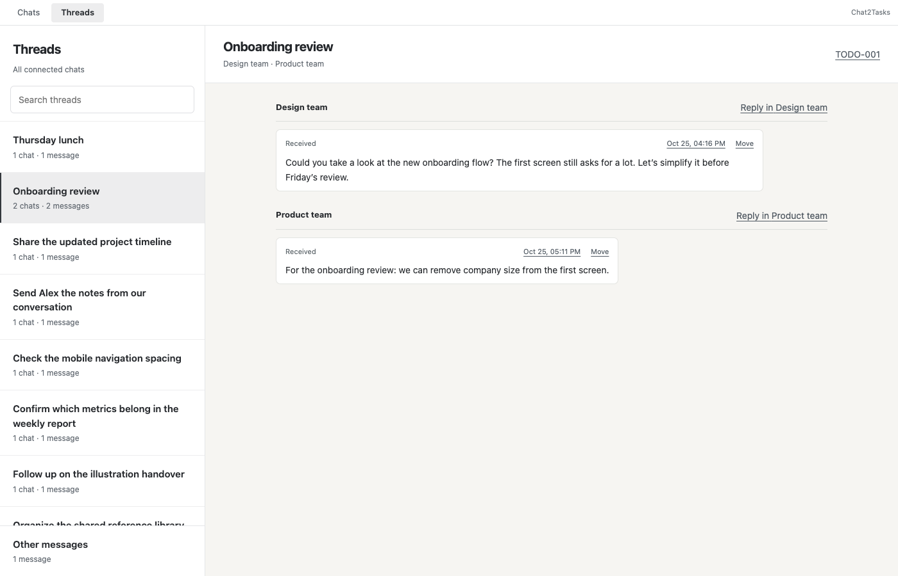

# WhatsApp Chats and Threads

The companion adds a small **Chats | Threads** switch inside WhatsApp Web. Chats preserves native reading and composing, with a quiet TODO reference under the last loaded source for each task. Threads collects a discussion across connected conversations using familiar two-pane navigation. The full workspace also has a Threads page.

Threads are independently stored discussions. They can exist without a TODO; related tasks are derived from shared source evidence. Each message retains its text, direction, timestamp, quote and media. Browser selections are explicitly labelled.

**Reply in…** returns to the original WhatsApp chat. It does not fill or submit the composer. Already loaded source messages receive focus; older history may need loading in WhatsApp. Browser selections without a WhatsApp ID can open their source chat, but cannot identify one original message.

## Organisation and corrections

First opening enables organisation using the selected model. Automatic mode processes changed evidence from active chats; manual mode uses **Organise now**. Paused chats retain readable history but are excluded from model input and new automatic assignments, including a pause during inference.

Every supplied message must occur exactly once in a valid model response. Unknown, missing and duplicate IDs reject the batch. Uncertain messages remain in **Other messages**. Successful fingerprints prevent repeated model calls during browsing. Failure requires a manual retry.

**Move** assigns a message to an existing topic, a new topic, or Other messages. This correction persists through regrouping, source edits and restart. A stale source or grouping revision returns a conflict. Moves update thread metadata without modifying original messages, task content, completion or personal notes.

## UI field mapping

| Source | Display or action |
| --- | --- |
| `discussion_threads.title` | Topic list name and selected heading |
| `thread_memberships.message_id` and `thread_id` | Topic messages and connected-source counts |
| `Message.sessionId` + `Message.chatId` matched to `Chat` | Source-chat identity and original-chat destination |
| `Chat.name` | Source heading; the browser can use its locally saved native name after matching unique WhatsApp IDs |
| `Message.body`, `direction`, `timestamp`, `reply_quote` | Unmodified text, sent/received label, local time and quote |
| `Message.browser_source` | Saved selection label, rather than attributing a capture to a participant |
| `Task.source_ids` intersecting topic member IDs | Related references from `Task.reference` |
| `Message.waMessageId` suffix and native `data-id` | Exact in-page association; ambiguous IDs produce no annotation |
| Original fingerprint plus membership revision | Conflict protection for manual moves |
| `Message.id` through the media route | Original image through existing OpenWA retrieval and cache |

The content script does not infer identity from similar text or archive additional page history. Network credentials stay in the service worker. Its shadow-root UI preserves native WhatsApp drafts when switching views.

## Update and validation

Download the ZIP from Settings, replace files in the existing unpacked extension folder, reload it in Chrome or Edge, approve WhatsApp Web access and refresh WhatsApp Web. Keeping the folder preserves its ID and pairing. Docker releases the backend and ZIP together.

These captures use fictional data in a disposable browser profile with a locally fulfilled WhatsApp-shaped page. They are not proof of installation in a personal browser:

- [Reading state](qa/whatsapp-threads/reading.png)
- [Cross-chat topic](qa/whatsapp-threads/threads.png)
- [Phone workspace](qa/whatsapp-threads/phone.png)

Checks cover ID matching, cross-chat and taskless topics, drafts and original text, source navigation, saved moves, stale corrections, pause during inference, revocation, cold-load selection and phone focus return. Existing completion, notes, merge and capture journeys remain in the browser suite.
